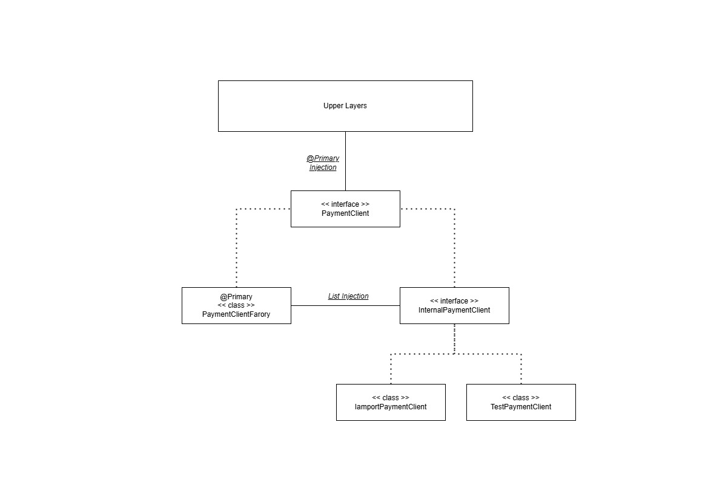

결제 모듈의 Resilience 테스트 코드입니다.

GraalVM 환경에선 Mock 주입 테스트가 불가능하였고, 이를 대처할 수 있는 방안을 모색하여 테스트하였습니다.

  
</img>
  

위 다이어 그램은 인프라 Client 레이어에 도메인 Client 인터페이스를 구현할 때 채택한 전략을 묘사해보았습니다.
가장 중심인 PaymentClientFactory가 @Primary하게 주입되며 해당 팩토리 클래스는 각 요청의 플랫폼에 맞게 InternalPaymentClient 구현체에 라우팅 되도록 설계하였고, 가짜 객체은 Mock 주입을 아무 기능 없거나 커스텀하여 사용할 수 있는 TestPaymentClient를 Component로 등록하여 사용하면 메인 소스에 영향을 주지 않고 느슨하고 다양하게 테스트를 진행할 수 있습니다.
